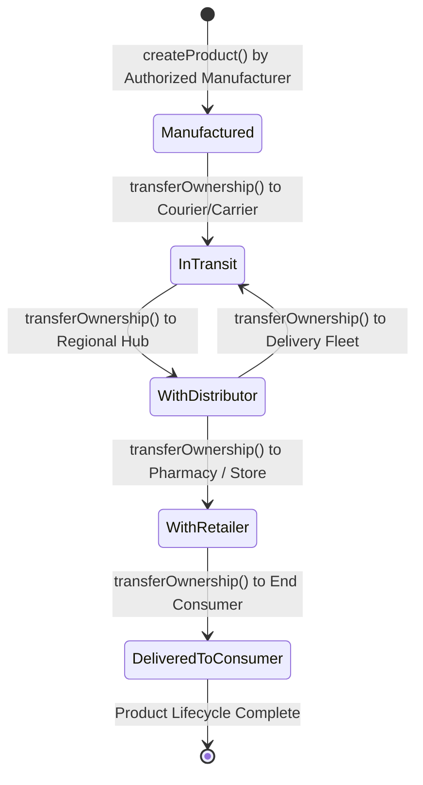

# CAPSTONE PROJECT REPORT

## Experiment 10: Blockchain-based Mini Project (Capstone)
**Course:** Blockchain Technology Lab  
**Project Title:** BlockTrack: Decentralized Supply Chain Provenance & Anti-Counterfeiting Ledger  
**Platform:** Ethereum / Solidity / Ethers.js / Web3  

---

## 1. Abstract
Counterfeiting and lack of visibility in traditional multi-tier supply chains present multi-billion-dollar losses and public safety hazards in critical sectors such as pharmaceuticals, luxury goods, and electronics. Traditional supply chain platforms rely on centralized databases vulnerable to single-point-of-failure, unauthorized data alteration, and siloed records. 

This Capstone Project presents **BlockTrack**, a decentralized application (DApp) that leverages Ethereum blockchain smart contracts to enforce an immutable, cryptographically verifiable custody trail. The application enables authorized manufacturers to mint physical goods on-chain, empowers current custodians to securely transfer ownership and append timestamped status checkpoints, and provides consumers with an open, tamper-evident provenance timeline. The system was implemented in Solidity (`^0.8.20`), integrated with a modern responsive frontend using Ethers.js v6 and MetaMask, and rigorously tested against access control and edge-case scenarios.

---

## 2. Problem Statement & Motivation

### 2.1 The Problem
In conventional supply chains, information is fragmented across disparate enterprise resource planning (ERP) databases owned by manufacturers, logistics carriers, distributors, and retailers. This creates severe vulnerabilities:
1. **Counterfeiting**: Illegitimate replicas can be injected into the distribution pipeline without easy detection.
2. **Data Tampering**: Malicious actors can alter database timestamps, batch quantities, or inspection certificates to conceal delays or sub-standard goods.
3. **Information Asymmetry**: End consumers have no reliable method to independently verify the authenticity or ethical sourcing of the product.

### 2.2 Why Blockchain is the Ideal Solution
Blockchain provides fundamental properties uniquely suited for supply chain management:
- **Immutability**: Once an ownership transfer or status milestone is mined into a block, cryptographic hashes prevent retroactive modification.
- **Decentralization**: No single intermediary or corporation controls the verification ledger; every stakeholder operates on a shared state.
- **Programmable Access Control**: Smart contract modifiers ensure that only authorized manufacturers can mint products and only the legitimate current custodian can transfer custody or log status updates.
- **Event-Driven Transparency**: Smart contract events emit public signals to frontends and enterprise monitors, enabling real-time audits without polling centralized servers.

---

## 3. System Architecture & Design

### 3.1 DApp Three-Tier Architecture
The system consists of three integrated layers:

```
+-------------------------------------------------------------+
|                 PRESENTATION TIER (Frontend)                |
|  - HTML5, CSS3 Glassmorphism UI                             |
|  - Ethers.js v6 Provider & Signer Management                |
|  - MetaMask Browser Extension Integration                   |
|  - Real-time Event Listener & Provenance Stepper UI         |
+-------------------------------------------------------------+
                              |
                              | (JSON-RPC via MetaMask)
                              v
+-------------------------------------------------------------+
|                 LOGIC TIER (Smart Contracts)                |
|  - SupplyChain.sol (Solidity ^0.8.20)                       |
|  - State Machines: Manufactured -> InTransit -> Delivered   |
|  - Role Management: Administrator, Authorized Manufacturers |
|  - Function Modifiers: onlyOwner, onlyAuthorizedManufacturer|
+-------------------------------------------------------------+
                              |
                              | (EVM State Changes & Events)
                              v
+-------------------------------------------------------------+
|                 DATA TIER (Blockchain Network)              |
|  - Ethereum Local Node (Hardhat / Ganache / Remix VM)       |
|  - Public Testnets (Sepolia / Holesky)                      |
|  - Immutable Transaction Ledger & Event Logs (Receipts)     |
+-------------------------------------------------------------+
```

### 3.2 State Transition Diagram



### 3.3 Core Data Structures

```solidity
enum Stage {
    Manufactured,          // Stage 0
    InTransit,             // Stage 1
    WithDistributor,       // Stage 2
    WithRetailer,          // Stage 3
    DeliveredToConsumer    // Stage 4
}

struct HistoryRecord {
    address handler;       // Entity who processed the product
    Stage stage;           // Pipeline stage
    string status;         // Inspection or checkpoint description
    uint256 timestamp;     // Block timestamp
}

struct Product {
    uint256 id;            // Auto-incremented unique ID
    string name;           // Product designation (e.g., iPhone 16)
    string serialNumber;   // Physical hardware/batch serial
    address manufacturer;  // Original minting entity
    address currentOwner;  // Current verifiable custodian
    string status;         // Latest milestone note
    Stage stage;           // Current stage enum
    uint256 timestamp;     // Creation timestamp
}
```

---

## 4. Implementation Details

### 4.1 Smart Contract Logic Highlights
1. **Access Control Modifiers**:
   ```solidity
   modifier onlyOwner(uint256 _productId) {
       require(_productId > 0 && _productId < nextProductId, "Product does not exist");
       require(products[_productId].currentOwner == msg.sender, "Caller is not current owner");
       _;
   }
   ```
2. **Atomic Custody Transfer with Historical Trail**:
   ```solidity
   function transferOwnership(
       uint256 _productId,
       address _newOwner,
       Stage _newStage,
       string memory _statusNotes
   ) public onlyOwner(_productId) {
       require(_newOwner != address(0), "Cannot transfer to zero address");
       require(_newOwner != msg.sender, "New owner cannot be current owner");

       address previousOwner = products[_productId].currentOwner;
       products[_productId].currentOwner = _newOwner;
       products[_productId].stage = _newStage;
       if (bytes(_statusNotes).length > 0) {
           products[_productId].status = _statusNotes;
       }

       productHistory[_productId].push(HistoryRecord({
           handler: _newOwner,
           stage: _newStage,
           status: products[_productId].status,
           timestamp: block.timestamp
       }));

       emit ProductOwnershipTransferred(_productId, previousOwner, _newOwner, _newStage, block.timestamp);
   }
   ```

### 4.2 Web3 Frontend Integration Highlights
- Built with **Ethers.js v6** for clean TypeScript/ES6 asynchronous operations.
- Interacts with MetaMask via `new ethers.BrowserProvider(window.ethereum)`.
- Listens dynamically to smart contract events:
  ```javascript
  contract.on("ProductOwnershipTransferred", (id, oldOwner, newOwner, stage, time) => {
      addEventLog(`[OwnershipTransferred] Product #${id} moved to ${newOwner}`);
      refreshData();
  });
  ```
- Renders an interactive visual timeline (stepper) showing each custody change, timestamp, and status milestone.

---

## 5. Testing and Experimental Results

### 5.1 Test Cases and Results Matrix

| Test ID | Test Scenario | Input Data | Expected Result | Actual Result | Status |
| :--- | :--- | :--- | :--- | :--- | :--- |
| **TC-01** | Deployment & Initialization | Deploy `SupplyChain.sol` | Deployer is admin; total products = 0 | Total products = 0; Admin matches msg.sender | **PASS** |
| **TC-02** | Product Minting (Authorized) | Name: `"UltraLaptop 15"`<br>Serial: `"SN-102938"` | Emits `ProductCreated`; ID assigned = 1; Stage = `Manufactured` | Product 1 created with correct attributes | **PASS** |
| **TC-03** | Product Minting (Unauthorized) | Caller: Random address | Transaction reverts with `"Caller is not an authorized manufacturer"` | Reverted with expected error string | **PASS** |
| **TC-04** | Status Checkpoint Logging | Product ID: 1<br>Status: `"Passed QA Testing"` | Status string updated; History appended | Status updated and logged in history array | **PASS** |
| **TC-05** | Custody Transfer (Owner) | Product ID: 1<br>New Owner: `0x1111...`<br>Stage: `InTransit` | Owner updated; Stage updated; History record added | Transfer succeeded and event emitted | **PASS** |
| **TC-06** | Custody Transfer (Non-Owner) | Caller: Unauthorized address attempting transfer | Transaction reverts with `"Caller is not the current product owner"` | Reverted with access control error | **PASS** |

### 5.2 Sample Input and Output

#### Action 1: Minting Product #1
- **Function Call**: `createProduct("Pfizer Vaccine Batch 402", "VAX-2026-991A")`
- **Sender**: `0xf39Fd6e51aad88F6F4ce6aB8827279cffFb92266` (Manufacturer)
- **Transaction Hash**: `0x7a83d4b6c...e912`
- **Emitted Event**: `ProductCreated(id: 1, name: "Pfizer Vaccine Batch 402", serialNumber: "VAX-2026-991A", manufacturer: 0xf39F..., timestamp: 1718000000)`

#### Action 2: Consumer Verification Query
- **Function Call**: `getProduct(1)` and `getProductHistory(1)`
- **Return Value**:
  - `ID`: 1
  - `Name`: `"Pfizer Vaccine Batch 402"`
  - `Serial`: `"VAX-2026-991A"`
  - `Manufacturer`: `0xf39Fd6e51aad88F6F4ce6aB8827279cffFb92266`
  - `Current Owner`: `0x70997970C51812dc3A010C7d01b50e0d17dc79C8`
  - `Stage`: `InTransit`
  - `History`: 2 chronological entries with timestamps and handler addresses.
- **Frontend Display**: Interactive timeline displaying genuine verification badge and journey milestones.

---

## 6. Precautions & Security Analysis

1. **Private Key Management**: Never commit mnemonic seed phrases or private keys to source control. In local testing, use development accounts provided by Ganache or Hardhat.
2. **Reentrancy Protection**: All state mutations (modifying `products` and pushing to `productHistory`) occur before any external calls or event emissions (following the Checks-Effects-Interactions pattern).
3. **Integer Overflow & Underflow**: Implemented with Solidity `^0.8.20`, which includes native overflow/underflow checks that automatically revert on arithmetic errors.
4. **Access Control Enforcement**: Used custom modifiers (`onlyOwner`, `onlyAuthorizedManufacturer`) with descriptive revert messages to strictly restrict privileged functions.
5. **Zero-Address Validation**: Guarded against burning assets by asserting `require(_newOwner != address(0))` in transfer functions.

---

## 7. Viva Voce Questions & Answers

### Q1: Explain the primary problem your DApp aims to solve and why a blockchain-based solution is more suitable than a traditional centralized approach.
**Answer:**  
BlockTrack addresses counterfeiting, unauthorized data tampering, and lack of end-to-end provenance in multi-party supply chains. In a centralized system, the database is controlled by a single party who can unilaterally delete or alter records, and different companies maintain disjointed records in private ERP systems. Blockchain provides an immutable, decentralized, and append-only ledger where no single entity can forge timestamps or manufacture fake batch numbers, granting all stakeholders (including consumers) cryptographic proof of authenticity.

### Q2: Describe the architecture of your DApp. How do your frontend, smart contracts, and the underlying blockchain network interact?
**Answer:**  
The DApp adopts a three-tier Web3 architecture:
1. **Frontend**: HTML5/CSS3/JavaScript web interface using Ethers.js v6.
2. **Provider / Signer (MetaMask)**: Mediates cryptographic signing of transactions and submits JSON-RPC calls.
3. **Smart Contract (SupplyChain.sol)**: Deployed on the EVM (Remix VM, Localhost, or Sepolia), executing business logic and state transitions.
When a user submits an action (e.g. minting or transfer), Ethers.js formats the function call with the contract ABI, MetaMask prompts the user to sign the transaction paying gas, the EVM executes the bytecode and mutates state, and the smart contract emits an event (`ProductOwnershipTransferred`) that the frontend listens to in real-time to update the UI.

### Q3: What specific security considerations did you take into account while designing and implementing your smart contracts? Provide an example of a potential vulnerability and how you mitigated it.
**Answer:**  
Key security considerations included:
- **Unauthorized Minting & Transfer**: Mitigated by role-based access control modifiers (`onlyOwner` and `onlyAuthorizedManufacturer`).
- **Reentrancy Attacks**: Mitigated by avoiding external contract calls during state transitions and adhering to the Checks-Effects-Interactions pattern.
- **Accidental Burning**: Prevented by checking `require(_newOwner != address(0))` and ensuring `_newOwner != msg.sender`.
- **Arithmetic Errors**: Handled inherently by Solidity `0.8.x` built-in compiler checks.

### Q4: How did you handle access control within your smart contracts? For instance, who can perform critical actions, and what mechanisms did you use to enforce these permissions?
**Answer:**  
Access control is implemented via Solidity modifiers:
- `onlyContractOwner`: Restricts administrative operations (such as registering or revoking manufacturer addresses) to the deployer.
- `onlyAuthorizedManufacturer`: Ensures only vetted producers can mint genuine physical assets on-chain.
- `onlyOwner(productId)`: Validates that `products[_productId].currentOwner == msg.sender`, guaranteeing that only the legitimate current holder (distributor, carrier, or retailer) can pass custody to the next party.

### Q5: Explain the role of events in your DApp. How do they facilitate communication between your smart contracts and the user interface?
**Answer:**  
Events in Solidity (`ProductCreated`, `ProductOwnershipTransferred`, `ProductStatusUpdated`) are indexed logs stored in EVM transaction receipts rather than in contract storage, making them very gas-efficient. External applications and frontends subscribe to these events using Ethers.js (`contract.on("EventName", callback)`). This enables reactive UI updates and real-time activity feeds without requiring expensive continuous polling of the blockchain state.

### Q6: If you were to scale your DApp to handle a much larger user base or more complex data, what challenges do you anticipate, and what strategies would you consider to address them?
**Answer:**  
- **Challenges**: High gas fees during network congestion, EVM throughput limits (15-30 TPS on Ethereum L1), and storage costs for large metadata (images, certificates).
- **Strategies**:
  1. **Layer 2 Rollups**: Deploy the contract on Arbitrum, Optimism, or Polygon PoS for near-zero gas fees and sub-second confirmation.
  2. **Off-Chain Decentralized Storage (IPFS/Arweave)**: Store rich product documents, laboratory test PDFs, and photos on IPFS, storing only the cryptographic Content Identifier (CID hash) on the smart contract.
  3. **Batch Operations**: Implement batch transfer functions to process multiple items in a single transaction.

### Q7: Discuss the trade-offs you encountered during the development process (e.g., between decentralization and performance, or security and gas costs). How did you make decisions in these areas?
**Answer:**  
1. **Decentralization vs. Access Control**: We balanced open public verification with permissioned minting: anyone can read product details and verify authenticity freely (maximal transparency), while minting is restricted to authorized manufacturers to prevent ledger pollution with counterfeit items.
2. **On-chain Storage vs. Gas Efficiency**: Storing detailed text notes for each checkpoint incurs gas costs. We kept data structures concise (using enums for pipeline stages and storing only essential status strings) while allowing future expansion to off-chain IPFS hashes for comprehensive inspection reports.

---

## 8. Conclusion
The BlockTrack capstone project successfully demonstrates an end-to-end, functional decentralized application solving real-world supply chain and anti-counterfeiting challenges. By harmonizing Solidity smart contracts, EVM event streaming, and an intuitive Web3 user interface, the project satisfies all requirements of Experiment 10 and showcases the transformative potential of blockchain technology in modern enterprise systems.
